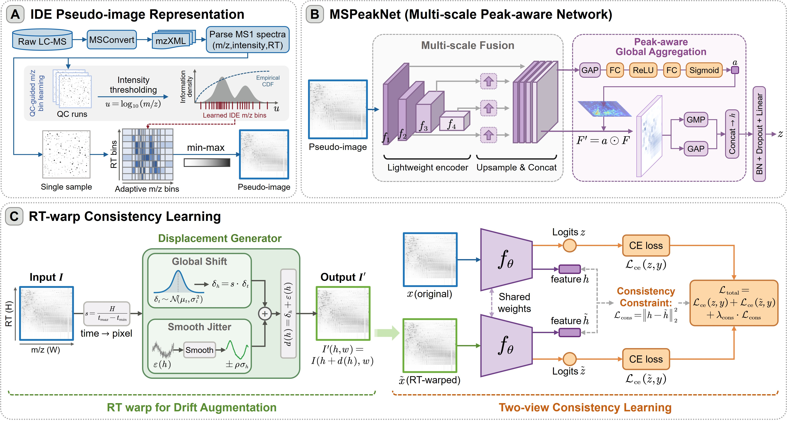
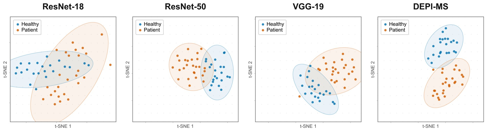
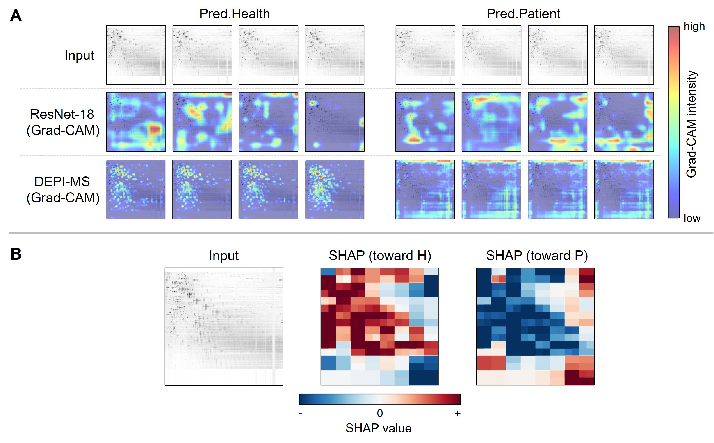
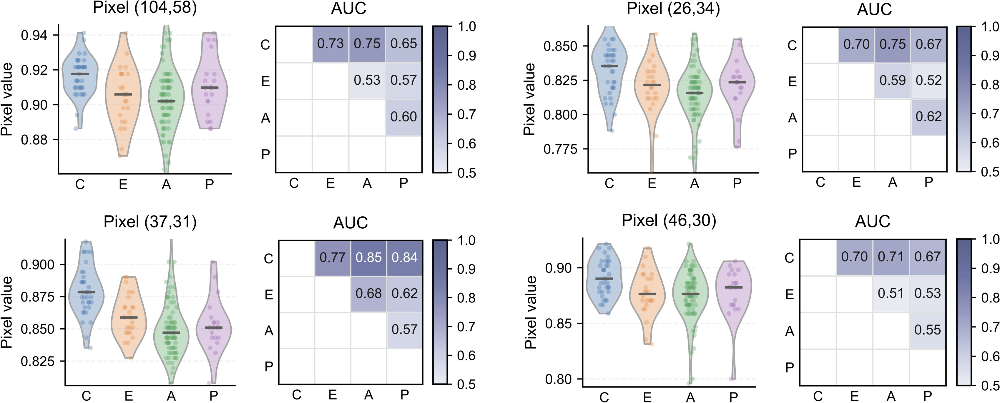

# DEPI-MS

Source code for DEPI-MS: Density-Equalized Pseudo-Image Learning for Drift-Tolerant LC-MS Metabolomics Classification.

DEPI-MS represents LC-MS data on a global RT-m/z grid with density-equalized m/z discretization, performs classification with MSPeakNet and RT-warp consistency learning, and maps model attention back to physical RT-m/z regions for LC-MS feature prioritization.

  

  Overview of the DEPI-MS framework used in the manuscript.

## Repository structure

~~~text
DEPI-MS/
├── assets/
│   ├── figure1_depi_ms_framework.jpg
│   ├── figure3_interpretability.jpg
│   ├── figure4_tsne_embeddings.jpg
│   └── figure5_consensus_pixels.jpg
├── metadata/
│   ├── five_fold_cv_patient.xlsx
│   ├── waibu_five_fold_cv.xlsx
│   └── peak_table_example.csv
├── examples/
│   └── mzXML/
│       └── README.md
├── depi_ms/
│   ├── pseudo_image/
│   │   ├── fit_density_equalized_bins.py
│   │   └── generate_pseudo_images.py
│   ├── training/
│   │   └── train_depi_ms.py
│   ├── inference/
│   │   └── infer_depi_ms.py
│   ├── visualization/
│   │   ├── plot_tsne.py
│   │   └── plot_violin.py
│   └── interpretation/
│       ├── gradcam_consensus.py
│       ├── map_hotspots_to_rt_mz.py
│       └── match_prioritized_features.py
├── docs/
│   └── REPRODUCIBILITY.md
├── environment.yml
├── requirements.txt
└── README.md
~~~

## Environment

For reproducibility, we use a Conda environment named depi-ms. The package versions match the software stack used for the experiments: Python 3.8.13, PyTorch 1.13.1+cu117, torchvision 0.14.1+cu117, and CUDA 11.7.

~~~bash
conda env create -f environment.yml
conda activate depi-ms
~~~

The pinned versions in requirements.txt reproduce the package stack used for the reported experiments.

## Data preparation

Pseudo-image construction accepts centroided LC-MS MS1 data in mzXML or mzML format. The NPC experiments use:

| Setting | Value |
| --- | --- |
| m/z range | 220-1000 |
| RT range | 50-900 s |
| Pseudo-image size | 224 x 224 |
| Intensity threshold | 500 |

Adaptive m/z boundaries are estimated from QC runs. RT is discretized uniformly.

Small example LC-MS files can be stored under `examples/mzXML/`. The pseudo-image converter accepts either a single mzML/mzXML file or a directory of files. For training or evaluation, the mzXML filename stem matches the sample ID in the corresponding split workbook.

### 1. Fit density-equalized m/z bins

~~~bash
python depi_ms/pseudo_image/fit_density_equalized_bins.py \
  --qc-dir /path/to/QC \
  --out-dir ./outputs/binning \
  --mz-min 220 --mz-max 1000 \
  --rt-min 50 --rt-max 900 \
  --H 224 --W 224 \
  --noise-threshold 500
~~~

The resulting NPZ file contains the adaptive m/z boundaries used for pseudo-image construction and inverse RT-m/z mapping.

### 2. Generate pseudo-images

After example files are added under `examples/mzXML/`, the whole directory can be converted in one run:

~~~bash
python depi_ms/pseudo_image/generate_pseudo_images.py \
  --file-name ./examples/mzXML \
  --output-path ./outputs/example_pseudo_images \
  --edges-npz ./outputs/binning/edges_mz_adaptive_rt_uniform_H224_W224.npz \
  --mz-min 220 --mz-max 1000 \
  --rt-min 50 --rt-max 900 \
  --mz-pixel 224 --rt-pixel 224 \
  --noise-threshold 500
~~~

Fit `--edges-npz` from the QC runs in Step 1. The example mzXML files serve as conversion inputs, while QC samples define the density-equalized m/z grid.

Generated images are written under `./outputs/example_pseudo_images/IDE_img224/`. For each input file, the script writes an unshifted `_0.png` view and a Shift-60 `_6.png` view used by the robustness-evaluation path. To process other data, replace `./examples/mzXML` with a single mzML/mzXML file or another input directory.

## Five-fold DEPI-MS training

The main NPC training configuration uses 50 epochs and a batch size of 32:

~~~bash
conda activate depi-ms

CUDA_VISIBLE_DEVICES=0 python depi_ms/training/train_depi_ms.py \
  --img-dir ./outputs/pseudo_images/IDE_img224 \
  --split-xlsx ./metadata/five_fold_cv_patient.xlsx \
  --epochs 50 \
  --batch-size 32 \
  --out-dir ./outputs/depi_ms
~~~

The internal split workbook is metadata/five_fold_cv_patient.xlsx. It contains Fold1-Fold5, with participant-level train_id and val_id columns. C is the healthy-control class and A/B/E/M are grouped as the NPC/case class.

During training, each input is paired with an RT-warped tensor view. The objective combines the classification losses of the original and warped views with a feature-consistency term.

## Inference and internal evaluation

The inference entry point loads the five final-epoch fold models and evaluates them without training.

~~~bash
CUDA_VISIBLE_DEVICES=0 python -m depi_ms.inference.infer_depi_ms \
  --img-dir ./outputs/pseudo_images/IDE_img224 \
  --split-xlsx ./metadata/five_fold_cv_patient.xlsx \
  --checkpoint-dir ./outputs/depi_ms \
  --view val0 \
  --out-dir ./outputs/internal_inference
~~~

Use --view val6 for the Shift-60 images or --view both for both views.

## External validation

External validation uses the five models trained from five_fold_cv_patient.xlsx. The external pseudo-images are provided through --img-dir, and waibu_five_fold_cv.xlsx supplies the external sample IDs.

~~~bash
CUDA_VISIBLE_DEVICES=0 python -m depi_ms.inference.infer_depi_ms \
  --img-dir /path/to/external/img224_IDE_mz \
  --split-xlsx ./metadata/waibu_five_fold_cv.xlsx \
  --checkpoint-dir ./outputs/depi_ms \
  --view val0 \
  --out-dir ./outputs/external_validation
~~~

waibu_five_fold_cv.xlsx contains the same 48 external samples in each fold. Fold 1 is evaluated with fold1/model_last.pth, Fold 2 with fold2/model_last.pth, and so on. The external-validation mean ± SD is calculated across the five fold-trained models.

## t-SNE visualization

The t-SNE utility follows the feature-extraction path used in the original analysis: it uses the global DEPI-MS feature returned by model(..., return_feat=True), applies PCA when needed, and then performs t-SNE. The example below visualizes the independent external validation cohort.

~~~bash
CUDA_VISIBLE_DEVICES=0 python -m depi_ms.visualization.plot_tsne \
  --img-dir /path/to/external/img224_IDE_mz \
  --split-xlsx ./metadata/waibu_five_fold_cv.xlsx \
  --checkpoint-dir ./outputs/depi_ms \
  --fold 1 \
  --view val0 \
  --out-dir ./outputs/tsne/external_fold1
~~~

The script saves the raw DEPI-MS features, the PCA input used by t-SNE, the two-dimensional coordinates, and PNG/PDF plots.

  

  Qualitative t-SNE visualization of sample embeddings on the NPC external validation cohort.

## Grad-CAM consensus and feature localization

Grad-CAM is generated from the final-epoch fold checkpoints. The script saves per-sample CAM arrays and overlays, then aggregates them into a cohort-level consensus mask.

~~~bash
CUDA_VISIBLE_DEVICES=0 python -m depi_ms.interpretation.gradcam_consensus \
  --img-dir ./outputs/pseudo_images/IDE_img224 \
  --split-xlsx ./metadata/five_fold_cv_patient.xlsx \
  --checkpoint-dir ./outputs/depi_ms \
  --folds all \
  --cam-quantile 0.90 \
  --cam-freq-thr 0.25 \
  --cam-balance class_weight
~~~

For each fold, the consensus files are written to foldN/gradcam/train/consensus/. The main coordinate output is heat_queue_xy.csv.

  

  Interpretability analyses reported in the manuscript.

### Violin plots for consensus-guided pixels

The violin utility calculates source values, class-wise summaries, and pairwise AUC values for every pixel listed in heat_queue_xy.csv. To keep the figure manageable, it plots at most 20 pixels by default while retaining all pixels in the output tables.

~~~bash
python -m depi_ms.visualization.plot_violin \
  --queue-csv ./outputs/depi_ms/fold4/gradcam/train/consensus/heat_queue_xy.csv \
  --img-dirs ./outputs/pseudo_images/IDE_img224 /path/to/post_treatment_images \
  --out-dir ./outputs/violin \
  --max-plot-pixels 20
~~~

Set --max-plot-pixels 0 to remove the plotting limit. The main outputs are violin_pixel_values_long.csv, violin_pixel_medians.csv, pairwise_auc_per_pixel_long.csv, violin_auc_plotted_pixels.png, and violin_auc_plotted_pixels.pdf. The subgroup mapping is C = healthy control, E = early-stage NPC, A = pooled A/B/M group, and P = pooled post-treatment group (postRT/postCT).

  

  Consensus-guided subgroup-associated pixel patterns reported in the manuscript.

### Map consensus pixels to RT-m/z intervals

~~~bash
python depi_ms/interpretation/map_hotspots_to_rt_mz.py \
  --heat-csv ./outputs/depi_ms/fold4/gradcam/train/consensus/heat_queue_xy.csv \
  --out-csv ./outputs/depi_ms/fold4/gradcam/train/consensus/heat_queue_rt_mz.csv \
  --edges-npz ./outputs/binning/edges_mz_adaptive_rt_uniform_H224_W224.npz \
  --mz-min 220 --mz-max 1000 \
  --rt-min 50 --rt-max 900 \
  --mz-pixel 224 --rt-pixel 224 \
  --index-base 0
~~~

### Match RT-m/z hotspots to the feature table

The repository includes a three-row example table at metadata/peak_table_example.csv with the columns No., RT (s), m/z, Intensity, and Identification Level.

~~~bash
python depi_ms/interpretation/match_prioritized_features.py \
  --heat-csv ./outputs/depi_ms/fold4/gradcam/train/consensus/heat_queue_rt_mz.csv \
  --feature-table ./metadata/peak_table_example.csv \
  --out-dir ./outputs/depi_ms/fold4/gradcam/train/prioritized_features \
  --id-col "No." \
  --rt-col "RT (s)" \
  --mz-col "m/z" \
  --thresholds 0.25 0.45
~~~

The matching uses the RT and m/z coordinates of each feature and the physical hotspot intervals reconstructed from the pseudo-image grid. Other columns, such as Intensity and Identification Level, are retained in the matched output.

## Main code path

| Stage | Script |
| --- | --- |
| QC-derived density equalization | depi_ms/pseudo_image/fit_density_equalized_bins.py |
| RT-m/z pseudo-image generation | depi_ms/pseudo_image/generate_pseudo_images.py |
| Five-fold DEPI-MS training | depi_ms/training/train_depi_ms.py |
| Checkpoint inference/evaluation | depi_ms/inference/infer_depi_ms.py |
| t-SNE embedding visualization | depi_ms/visualization/plot_tsne.py |
| Grad-CAM and cohort consensus | depi_ms/interpretation/gradcam_consensus.py |
| Consensus-pixel violin/AUC visualization | depi_ms/visualization/plot_violin.py |
| Pixel-to-RT/m/z inverse mapping | depi_ms/interpretation/map_hotspots_to_rt_mz.py |
| Peak-pair feature matching | depi_ms/interpretation/match_prioritized_features.py |

Additional input conventions and implementation details are provided in docs/REPRODUCIBILITY.md.

## Citation

If you use this code, please cite:

Xiaohui Lin et al. DEPI-MS: Density-Equalized Pseudo-Image Learning for Drift-Tolerant LC-MS Metabolomics Classification. Analytical Chemistry.

## Contact

For questions about the code, please open an issue in this repository.